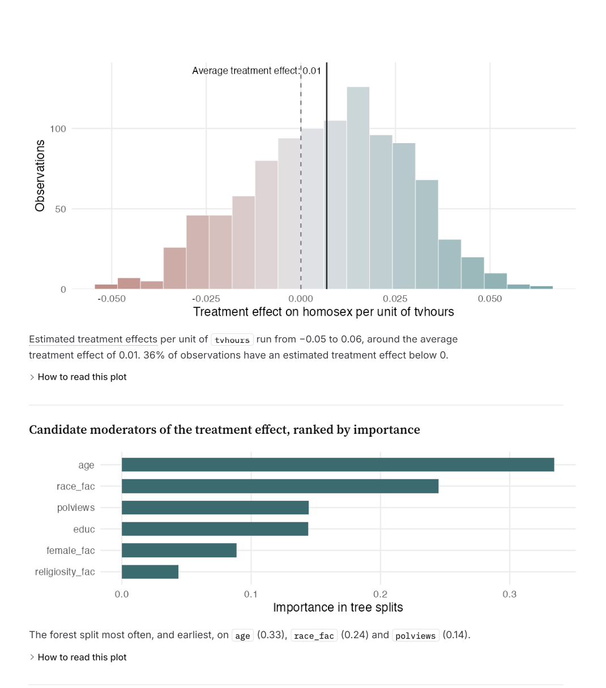
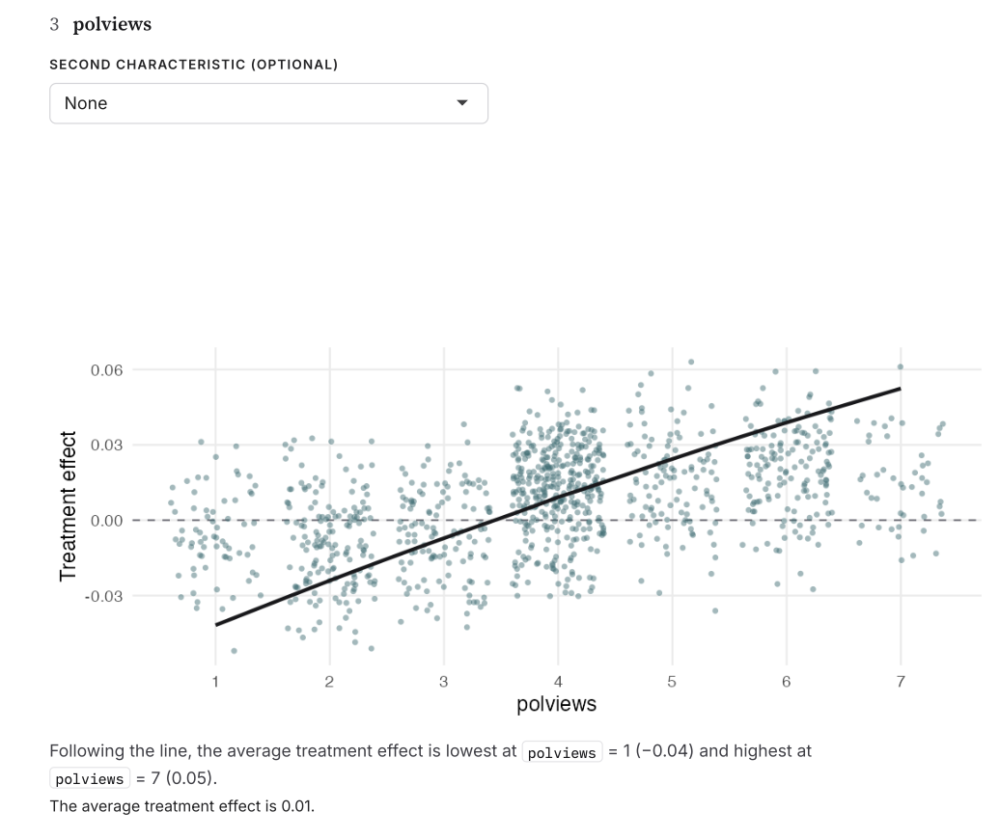
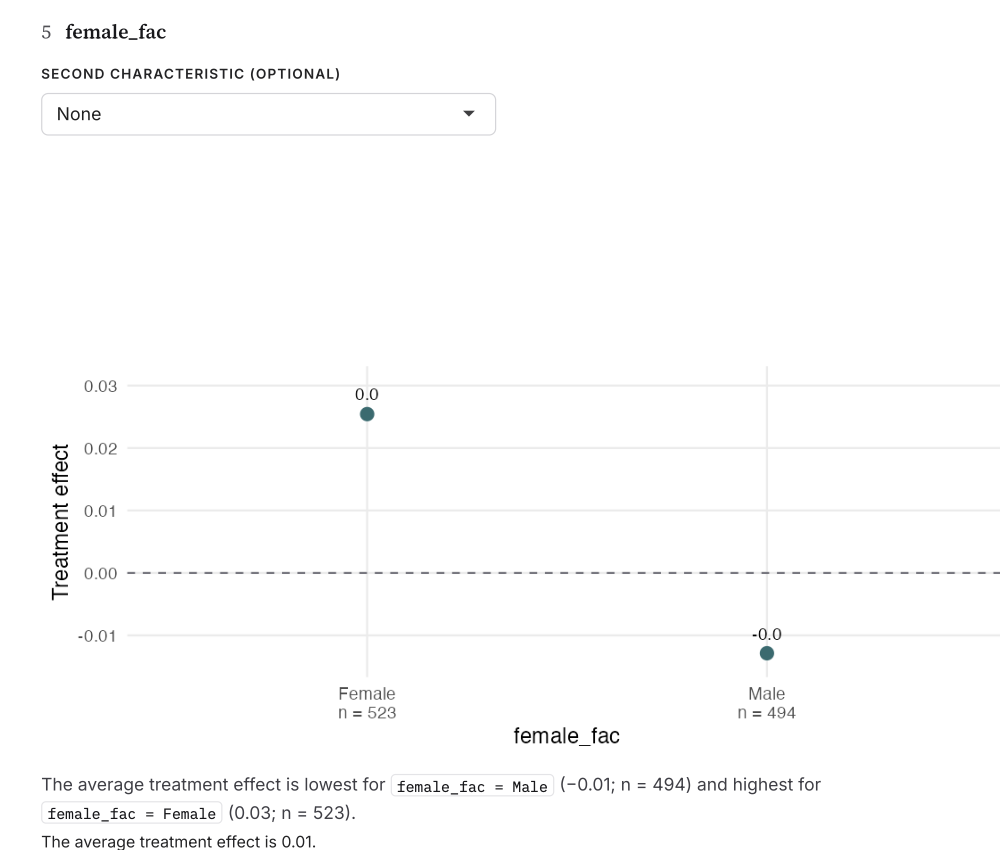

```{r setup, include=FALSE}
knitr::opts_chunk$set(
  warning = FALSE,
  message = FALSE, 
  echo = TRUE        
)
```

# Summary

1.  They test moderation not only with political orientation and sex, but also race, age, education level, and religiosity. But only political orientation and sex are significant moderators and kept in the stepwise analysis.
2.  A note is that, the original paper probably included 11 NA values in race 1 and coded as asian and pacific islanders, which is not consistent with the GSS codebook. But it seems to be the only way to replicate their results.
3.  Their moderation analysis found out that the only for conservative and female, TV viewing is positively associated with perceived morality of same-sex behaviors and support for same-sex marriage.
4.  The causal forest, in terms of these two moderators, also found similar conclusion (though liberal seems to have a opposite(negative) effect, while in the original paper it was insignificant.
5.  However, in the causal forest, some other variables. e.g., age and race, are more important than political view and sex, but those were reported as insignificant in the original paper.

# Step 1: Simply try to replicate the result in the original paper

## Data Loading and Cleaning

```{r lib, include=FALSE}
library(haven)
library(tidyverse)
library(skimr)
library(scales)
library(broom)
```

```{r}
GSS2022 <- read_sav("GSS2022.sav")
gss_cross <- GSS2022 %>%
  filter(sample == 10) 

nrow(gss_cross)
```

this matches their report of "3,544 total respondents" for 2022 GSS.

```{r}
b1_data <- gss_cross %>%
  rename_with(tolower) %>%
  filter(ballot == 1)

nrow(b1_data)
```

```{r}
# 1. Clean analytical sample (N = 1,017)
final_1017 <- b1_data %>%
  drop_na(tvhours, homosex, marsame, polviews, age, educ, sex) %>%
  mutate(
    # Continuous variables
    across(c(tvhours, homosex, polviews, age, educ), as.numeric),
    marsame_rev = 6 - as.numeric(marsame), # recoded so higher = more positive
    
    # 1) Sex
    female = ifelse(as.numeric(sex) == 2, 1, 0),
    female_fac = factor(ifelse(female == 1, "Female", "Male"), levels = c("Male", "Female")),
    
    # 2) Religiosity (bible = 1 as High, others/missing as Low)
    bible_comb = coalesce(as.numeric(bible), as.numeric(biblenv), as.numeric(biblev)),
    high_religiosity = ifelse(!is.na(bible_comb) & bible_comb == 1, 1, 0),
    religiosity_fac = factor(
      ifelse(high_religiosity == 1, "High religiosity", "Low religiosity"),
      levels = c("Low religiosity", "High religiosity")
    ),
    
    # 3) Race classification matching exact paper distribution
    rc1 = as.numeric(racecen1),
    rc2 = as.numeric(racecen2),
    is_mixed = !is.na(rc2) & rc2 > 0,
    
    race_fac = factor(
      case_when(
        is_mixed | rc1 == 15 ~ "Other and mixed races",
        rc1 == 1 ~ "White",
        rc1 == 2 ~ "Black",
        rc1 == 3 ~ "Native American",
        rc1 == 16 ~ "Hispanic",
        (rc1 %in% 4:14) | is.na(rc1) ~ "Asian and Pacific Islanders",
        TRUE ~ "Other and mixed races"
      ),
      levels = c(
        "White", "Black", "Native American", 
        "Asian and Pacific Islanders", "Hispanic", "Other and mixed races"
      )
    ),
    race_black = ifelse(race_fac == "Black", 1, 0),
    race_native = ifelse(race_fac == "Native American", 1, 0),
    race_asian = ifelse(race_fac == "Asian and Pacific Islanders", 1, 0),
    race_hispanic = ifelse(race_fac == "Hispanic", 1, 0),
    race_other = ifelse(race_fac == "Other and mixed races", 1, 0)
  ) %>%
  select(
    id, tvhours, homosex, marsame_rev, polviews, age, educ,
    female, female_fac,
    high_religiosity, religiosity_fac,
    race_fac, race_black, race_native, race_asian, race_hispanic, race_other
  )
# political view: 1 = Extremely liberal
```

```{r}
nrow(final_1017)
```

## 1. Replicate Descriptive Analysis

```{r des,echo = FALSE}
# 2. Table 1: Continuous variables (Mean, SD, Min, Max in long table format)
final_1017 %>%
  select(tvhours, homosex, marsame_rev, polviews, age, educ) %>%
  skim() %>%
  yank("numeric") %>%
  select(variable = skim_variable, mean, sd, min = p0, max = p100) %>%
  mutate(across(where(is.numeric), ~ round(.x, 2))) %>%
  knitr::kable()
```

```{r des2, echo=FALSE}
# 3. Table 2: Categorical variables (Counts and Percentages in long table format)
bind_rows(
  final_1017 %>% count(variable = female_fac),
  final_1017 %>% count(variable = religiosity_fac),
  final_1017 %>% count(variable = race_fac)
) %>%
  mutate(pct = round(n / nrow(final_1017) * 100, 1)) %>%
  select(variable, n, pct)%>%
  knitr::kable()
```

This descriptive analysis matches the paper's results. Some examples are:

*"Among these 1,017 respondents, 70.8% identified as White, 13.7% as Black, 1.2% as Native American, 3.9% as Hispanic, 3.3% as Asian and Pacific Islanders, and 7.1% as other or mixed races."* ;

*"The key independent variable in this study was television viewing..The mean of the sample was 3.29 (SD = 3.50)."*

## 2. Replicate Regression Analysis - Main

```{r main, echo = FALSE}
# 1. Fit Table 1 models
m1_homo <- lm(homosex ~ tvhours + female + race_fac + age + educ + polviews + high_religiosity, data = final_1017)
m1_mars <- lm(marsame_rev ~ tvhours + female + race_fac + age + educ + polviews + high_religiosity, data = final_1017)

# 2. Extract and format coefficients & p-values into paper layout
coef_table <- left_join(
  tidy(m1_homo) %>% select(term, b_homo = estimate, p_homo = p.value),
  tidy(m1_mars) %>% select(term, b_mars = estimate, p_mars = p.value),
  by = "term"
) %>%
  filter(term != "(Intercept)") %>%
  mutate(
    Variable = case_match(
      term,
      "tvhours" ~ "Television viewing",
      "female" ~ "Female (reference: Male)",
      "race_facBlack" ~ "Race: Black",
      "race_facNative American" ~ "Race: Native American",
      "race_facAsian and Pacific Islanders" ~ "Race: Asian and Pacific Islanders",
      "race_facHispanic" ~ "Race: Hispanic",
      "race_facOther and mixed races" ~ "Race: Other and mixed races",
      "age" ~ "Age",
      "educ" ~ "Education level",
      "polviews" ~ "Political orientation",
      "high_religiosity" ~ "High religiosity (reference: Low religiosity)"
    ),
    b_homo = sprintf("%.2f", b_homo),
    p_homo = ifelse(p_homo < .001, "< .001", sprintf("%.3f", p_homo)),
    b_mars = sprintf("%.2f", b_mars),
    p_mars = ifelse(p_mars < .001, "< .001", sprintf("%.3f", p_mars))
  ) %>%
  select(Variable, b_homo, p_homo, b_mars, p_mars)

# 3. Model fit statistics (F, R2, Adj. R2)
fit_table <- tibble(
  Variable = c("F value", "R2", "Adjusted R2"),
  b_homo = c(sprintf("%.2f", summary(m1_homo)$fstatistic[1]),
             sprintf("%.2f", summary(m1_homo)$r.squared),
             sprintf("%.2f", summary(m1_homo)$adj.r.squared)),
  p_homo = c("< .001", "", ""),
  b_mars = c(sprintf("%.2f", summary(m1_mars)$fstatistic[1]),
             sprintf("%.2f", summary(m1_mars)$r.squared),
             sprintf("%.2f", summary(m1_mars)$adj.r.squared)),
  p_mars = c("< .001", "", "")
)

# 4. Display Table 1
table_1 <- bind_rows(coef_table, fit_table)
as.data.frame(table_1)
```

This result replicate the original paper's Table 1:


## 3. Replicate Regression Analysis - Moderation

```{r, echo=FALSE}
# 1. Fit Table 2 models with retained interaction terms
m2_homo <- lm(homosex ~ tvhours + female + race_fac + age + educ + polviews + high_religiosity + tvhours:female + tvhours:polviews, data = final_1017)
m2_mars <- lm(marsame_rev ~ tvhours + female + race_fac + age + educ + polviews + high_religiosity + tvhours:polviews, data = final_1017)

# 2. Extract and format coefficients & p-values
terms_order <- c(
  "tvhours", "female", "race_facBlack", "race_facNative American",
  "race_facAsian and Pacific Islanders", "race_facHispanic", "race_facOther and mixed races",
  "age", "educ", "polviews", "high_religiosity", "tvhours:female", "tvhours:polviews"
)

coef_table2 <- tibble(term = terms_order) %>%
  left_join(tidy(m2_homo) %>% select(term, b_homo = estimate, p_homo = p.value), by = "term") %>%
  left_join(tidy(m2_mars) %>% select(term, b_mars = estimate, p_mars = p.value), by = "term") %>%
  mutate(
    Variable = case_match(
      term,
      "tvhours" ~ "Television viewing",
      "female" ~ "Female (reference: Male)",
      "race_facBlack" ~ "Race: Black",
      "race_facNative American" ~ "Race: Native American",
      "race_facAsian and Pacific Islanders" ~ "Race: Asian and Pacific Islanders",
      "race_facHispanic" ~ "Race: Hispanic",
      "race_facOther and mixed races" ~ "Race: Other and mixed races",
      "age" ~ "Age",
      "educ" ~ "Education level",
      "polviews" ~ "Political orientation",
      "high_religiosity" ~ "High religiosity (reference: Low religiosity)",
      "tvhours:female" ~ "Television viewing × Female",
      "tvhours:polviews" ~ "Television viewing × Political orientation"
    ),
    b_homo = sprintf("%.2f", b_homo),
    p_homo = ifelse(p_homo < .001, "< .001", sprintf("%.3f", p_homo)),
    b_mars = ifelse(is.na(b_mars), "---", sprintf("%.2f", b_mars)),
    p_mars = ifelse(is.na(p_mars), "---", ifelse(p_mars < .001, "< .001", sprintf("%.3f", p_mars)))
  ) %>%
  select(Variable, b_homo, p_homo, b_mars, p_mars)

# 3. Model fit statistics (F, R2, Adj. R2)
fit_table2 <- tibble(
  Variable = c("F value", "R2", "Adjusted R2"),
  b_homo = c(sprintf("%.2f", summary(m2_homo)$fstatistic[1]),
             sprintf("%.2f", summary(m2_homo)$r.squared),
             sprintf("%.2f", summary(m2_homo)$adj.r.squared)),
  p_homo = c("< .001", "", ""),
  b_mars = c(sprintf("%.2f", summary(m2_mars)$fstatistic[1]),
             sprintf("%.2f", summary(m2_mars)$r.squared),
             sprintf("%.2f", summary(m2_mars)$adj.r.squared)),
  p_mars = c("< .001", "", "")
)

# 4. Display Table 2
table_2 <- bind_rows(coef_table2, fit_table2)
as.data.frame(table_2)
```

The analysis does not use Process and bootstrapping method, but the results still mostly replicate the paper's Table 2:


## 4. Their moderation conclusion: aim for next step

-   **No Direct Association in Full Sample**: Television viewing showed no statistically significant main effect on perceived morality of same-sex behaviors ($b = .01, p = .301$) or support for same-sex marriage ($b = .01, p = .205$).

-   **Political Moderation (Mainstreaming Pattern)**:

    -   **Conservatives**: Heavy TV viewing had a significant positive ("liberalizing") association with both morality beliefs ($b = .04, p < .05$) and marriage support ($b = .05, p < .01$).

    -   **Moderates & Liberals**: No significant association on either outcome (partly due to a statistical ceiling effect among liberals).

        -   **Theoretical Takeaway**: Views converged among heavy viewers across political lines, confirming a **mainstreaming** effect.

-   **Sex Moderation (Resonance Pattern)**:

    -   **Women**: TV viewing was positively associated with perceived morality of same-sex behaviors ($b = .03, p < .05$).

    -   **Men**: No significant association ($b = -.01, p = .33$).

    -   **Theoretical Takeaway**: TV viewing widened the gap between men and women rather than converging them—reflecting **resonance** (attributed to women's broader social exposure and more fluid gender attitudes).

    -   *Note*: Sex moderation was not significant for support for same-sex marriage and was dropped from that model.

-   **Non-Significant Moderators**: Race, age, education level, and religiosity did not yield significant interactions with TV viewing and were excluded from final models.

# Step 2: Replication with causal forests

We first export the data which can mostly replicate their results (descriptive analysis and regression)

```{r}
write_csv(final_1017,'final_1017.csv')
```

Then, we import this data to the heterogeneity app to see if it give similar conclusion.

```{r, eval=FALSE, echo=TRUE}
# Install heterogeneity package in R

if (!requireNamespace("remotes", quietly = TRUE)) {
  install.packages("remotes")
}
remotes::install_github("invisibleinfo/heterogeneity")

heterogeneity::run_app()
```

Those are some of the causal forests result (i.e., sex and political view, which are found significant in the original paper), but see the pdf file for all the analysis.






