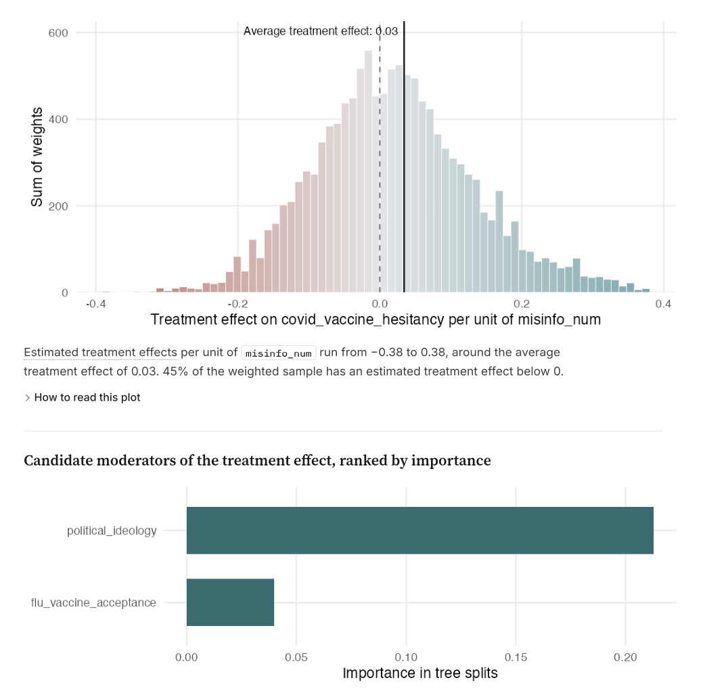
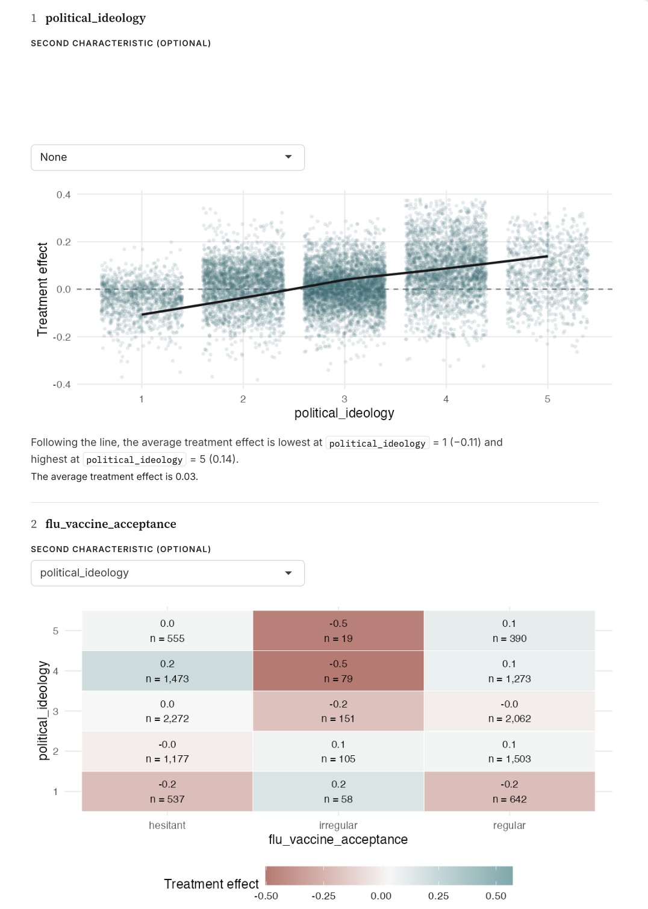

```{r setup, include=FALSE}
knitr::opts_chunk$set(
  warning = FALSE,
  message = FALSE, 
  echo = TRUE        
)
```

# Step 1: Simply try to replicate the result in the original paper

## Summary of the Discrepancy

1.  the original paper made a mistake with reporting education and income with same mean and sd (which is generally impossible).
2.  the original paper seemingly did not discuss handling NA in their paper, so we cannot be fully sure if we are using the same sub-dataset.
3.  Currently I can not replicate the regression result, both in R and SPSS, though the descriptive analyis is replicated.
4.  For causal forest, the two way moderation about political orientation seems to be replicated, but not (so much) about the three way moderation (political orientation X flu acceptance)
5.  To be noted, the IV here is misinformation related to 2022 US presidential election, but not about the Covid or flu directly.

## Data Loading and Cleaning

```{r lib, include=FALSE}
library(haven)
library(tidyverse)
library(skimr)
library(scales)
df <- read_sav("ATP W79.sav")
```

```{r}
nrow(df)
```

```{r}
# 1. Pre-process target variables
df <- df |>
  # 1.1 Convert all "99" (Refused) values to NA across the dataset
  mutate(across(where(is.numeric), ~ na_if(., 99))) |>
  
  # 1.2 Generate IDs and transform analysis variables
  mutate(
    # Generate sequential 5-digit string ID (e.g., "00001")
    id = sprintf("%05d", row_number()),
    
    # --- DV ---
    covid_vaccine_hesitancy = COVID_SCI6E_W79,
    
    # --- IV ---
    # Perceived misinformation exposure: 4-point scale reverse-coded (1->4, 2->3, 3->2, 4->1)
    misinfo_exposure = 5 - CAMP20MISINFO_W79,
    
    # --- Moderators ---
    # Political ideology: 5-point scale reverse-coded (1->5, 2->4, 3->3, 4->2, 5->1)
    political_ideology = 6 - F_IDEO,
    
# Flu vaccine acceptance: reverse items first, then multiply
    # SCI_FLU1 (1=Yes, 2=No) -> reversed: 1=No, 2=Yes (3 - x)
    # SCI_FLU2 (1=Every yr, 2=Every few yrs, 3=Rarely/Never) -> reversed: 1=Rarely, 2=Every few yrs, 3=Every yr (4 - x)
    # Product: 1-3 = hesitant, 4 = irregular, 6 = regular
    sci_flu1_rev = 3 - as.numeric(SCI_FLU1_W79),
    sci_flu2_rev = 4 - as.numeric(SCI_FLU2_W79),
    flu_interaction = sci_flu1_rev * sci_flu2_rev,
    flu_vaccine_acceptance = case_when(
      flu_interaction >= 1 & flu_interaction <= 3 ~ "hesitant",
      flu_interaction == 4                        ~ "irregular",
      flu_interaction == 6                        ~ "regular",
      TRUE                                        ~ NA_character_
    ),
    flu_vaccine_acceptance = factor(
      flu_vaccine_acceptance, 
      levels = c("hesitant", "irregular", "regular")
    ),
    
    # --- Covariates ---
    religion       = F_RELIGCAT1,
    age            = F_AGECAT,
    education      = F_EDUCCAT2,
    gender         = F_GENDER,
    marital_status = F_MARITAL,
    income         = F_INC_SDT1,
    race           = F_RACECMB,
    
    # --- Survey Weight ---
    weight         = WEIGHT_W79
  )

# 2. Confirm Variables (Primary analysis set)
confirm_cols <- c(
  id                      = "id",
  covid_vaccine_hesitancy = "covid_vaccine_hesitancy",
  misinfo_exposure        = "misinfo_exposure",
  political_ideology      = "political_ideology",
  flu_interaction         = "flu_interaction",
  flu_vaccine_acceptance  = "flu_vaccine_acceptance",
  religion                = "religion",
  age                     = "age",
  education               = "education",
  gender                  = "gender",
  marital_status          = "marital_status",
  income                  = "income",
  race                    = "race",
  weight                  = "weight"
)

# 3. Explore Variables (Raw variables preserved for verification/reference)
explore_cols <- c(
  metropolitan = "F_METRO",
  citizenship  = "F_CITIZEN"
)

# 4. Merge column definitions
final_cols <- c(confirm_cols, explore_cols)

# 5. Extract analytical subsets
df_conf <- df |> 
  select(all_of(confirm_cols))

df_exp <- df |> 
  select(all_of(final_cols))
```

## Replication Results

### 1.Quick Overview of core variables/Descriptive Statistics

```{r}
skim(df_conf)
```

```{r}
library(dplyr)
library(srvyr)
library(haven)
library(tidyr)
options(digits = 3)

# 1. remove labels
df_clean <- df_conf %>%
  zap_labels() %>%
  mutate(across(where(is.numeric), as.numeric)) %>%
  filter(!is.na(weight))

# 2. add weight
survey_design <- df_clean %>%
  as_survey_design(weights = weight)

# 3. calculate weighted mean and sd
target_vars <- c("covid_vaccine_hesitancy", "misinfo_exposure", "political_ideology", "flu_interaction", "age", "education", "income")

weighted_stats <- survey_design %>%
  summarise(across(
    all_of(target_vars),
    list(
      mean = ~ survey_mean(.x, na.rm = TRUE),
      sd   = ~ survey_sd(.x, na.rm = TRUE)
    ),
    .names = "{.col}__{.fn}"
  )) %>%
  pivot_longer(
    cols = everything(),
    names_to = c("variable", ".value"),
    names_sep = "__"
  )

print(weighted_stats)
```

These results replicate the descriptive analysis in the original paper, except that the original paper made a mistake with reporting education and income with same mean and sd (which is generally impossible). The correct mean and sd are reported here.

### 2.Missing Values

Note: The original authors seemingly did not discuss handling NA in their paper)

```{r}
# 2. Listwise deletion for df_confirm and check sample size
df_clean_noNA <- df_conf |> drop_na()
nrow(df_clean_noNA)
```

1.  number of cases: Numbers of row (N = 11578) in `df_conf_noNA`; while the original paper only report the full raw sample size (N = 12648).

### 3.Try to replicate the regression results

```{r}
library(dplyr)
library(broom)

df_reg <- df_clean |>
  mutate(
    # Flu vaccine acceptance score (continuous)
    flu_acc = as.numeric(flu_interaction),

    # Religion: Catholic as reference
    religion_factor = factor(
      case_when(
        religion == 2 ~ "Catholic",
        religion == 1 ~ "Protestant",
        religion == 3 ~ "Unaffiliated",
        religion >= 4 ~ "Others",
        TRUE ~ NA_character_
      ),
      levels = c("Catholic", "Protestant", "Unaffiliated", "Others")
    ),

    # Age: 18–29 as reference
    age_factor = factor(
      case_when(
        age == 1 ~ "18_29",
        age == 2 ~ "30_49",
        age == 3 ~ "50_64",
        age == 4 ~ "65_plus",
        TRUE ~ NA_character_
      ),
      levels = c("18_29", "30_49", "50_64", "65_plus")
    ),

    # Gender: Male as reference
    gender_factor = factor(
      case_when(
        gender == 1 ~ "Male",
        gender == 2 ~ "Female",
        gender >= 3 ~ "Others",
        TRUE ~ NA_character_
      ),
      levels = c("Male", "Female", "Others")
    ),

    # Race: White as reference
    race_factor = factor(
      case_when(
        race == 1 ~ "White",
        race == 2 ~ "Black",
        race == 3 ~ "Asian",
        race == 4 ~ "Mixed",
        race >= 5 ~ "Other",
        TRUE ~ NA_character_
      ),
      levels = c("White", "Black", "Asian", "Mixed", "Other")
    ),

    # Marital status: Not Married as reference
    marital_factor = factor(
      case_when(
        marital_status == 1 ~ "Married",
        marital_status >= 2 ~ "Not Married",
        TRUE ~ NA_character_
      ),
      levels = c("Not Married", "Married")
    ),

    # Continuous predictors
    education_num = as.numeric(education),
    income_num = as.numeric(income),
    ideology_num = as.numeric(political_ideology),
    misinfo_num = as.numeric(misinfo_exposure)
  )
```

```{r}
model_flu_cont <- lm(
  covid_vaccine_hesitancy ~
    religion_factor +
    age_factor +
    education_num +
    income_num +
    gender_factor +
    marital_factor +
    race_factor +
    ideology_num +
    flu_acc +
    misinfo_num,
  data = df_reg
)

summary(model_flu_cont)
```

# Step 2: Replication with causal forests

We first export the data which can mostly replicate their results (descriptive analysis and logistic regression)

```{r}
write_csv(df_reg,'df_reg.csv')
```

Then, we import this data to the heterogeneity app to see if it give similar conclusion.

```{r, eval=FALSE, echo=TRUE}
# Install heterogeneity package in R

if (!requireNamespace("remotes", quietly = TRUE)) {
  install.packages("remotes")
}
remotes::install_github("invisibleinfo/heterogeneity")

heterogeneity::run_app()
```

**originally, in the paper**:

Two-Way Moderation (Political Ideology as Moderator):

-   Exposure to misinformation significantly increases vaccine hesitancy among **moderates** ($b = 0.03, p < 0.001$) and **conservatives** ($b = 0.07, p < 0.001$), but has no significant effect on liberals ($b = -0.01, p = 0.82$).

Three-Way Moderation (Flu Vaccine Acceptance as Second Moderator):

-   Flu vaccine acceptance further moderates this relationship ($b = -0.011, p < 0.001$).

-   *Flu-hesitant group*: Misinformation exposure **strongly** increases COVID-19 vaccine hesitancy among both conservatives ($b = 0.12, p < 0.001$) and moderates ($b = 0.06, p < 0.001$).

-   *Flu-irregular group*: The harmful effect **weakens but remains significant** for conservatives ($b = 0.06, p < 0.001$) and moderates ($b = 0.03, p < 0.05$).

-   *Flu-regular group*: Misinformation exposure has **no significant** impact on COVID-19 vaccine hesitancy across any political group—including conservatives.




