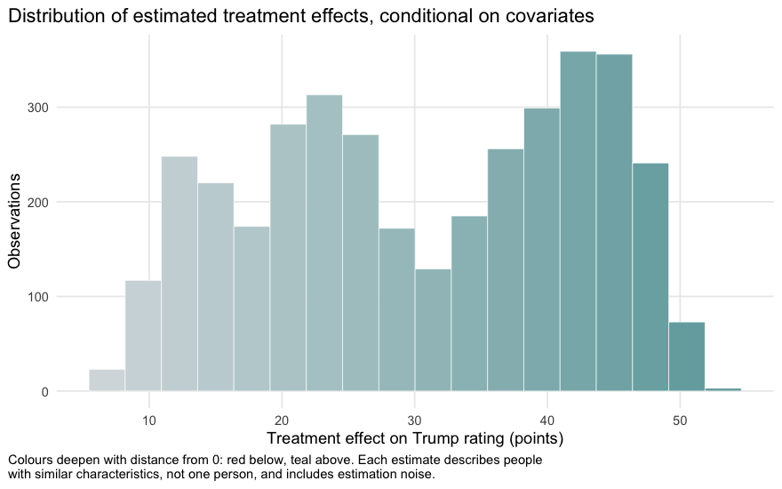
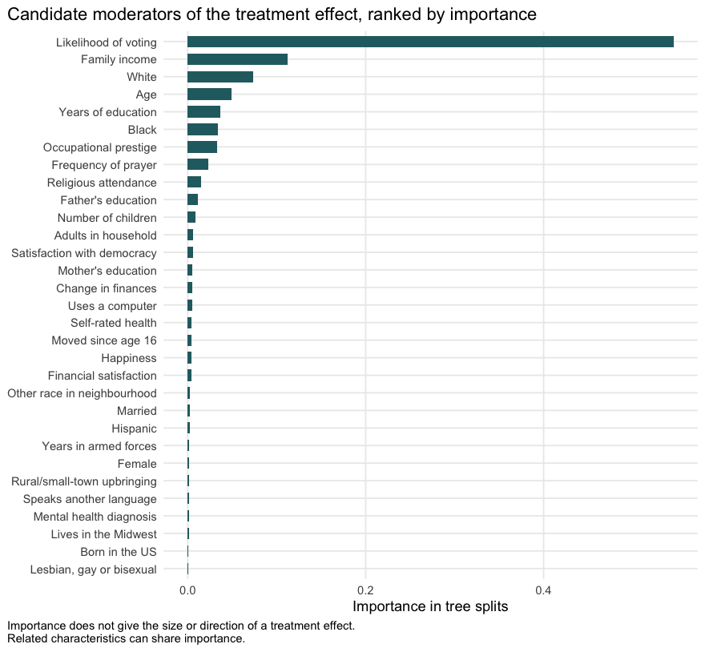
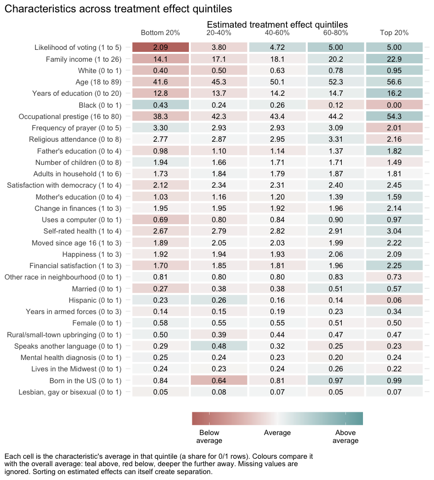
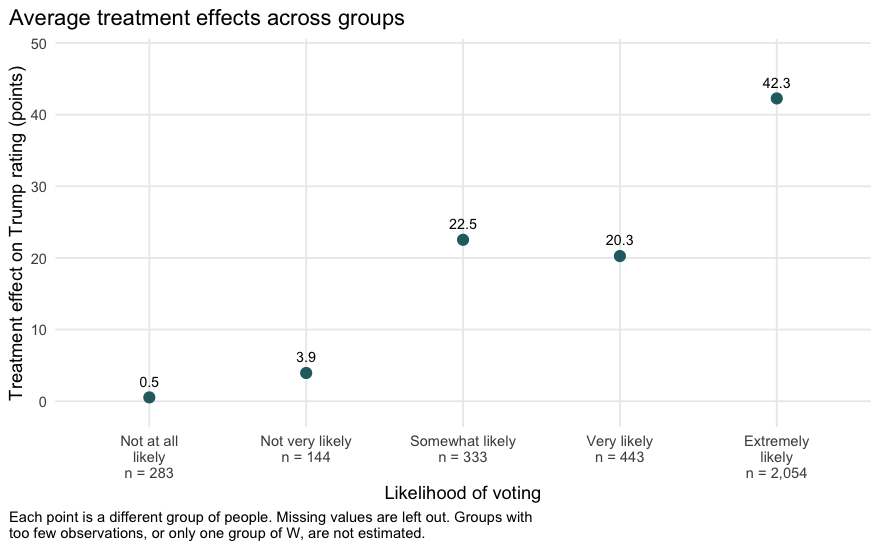
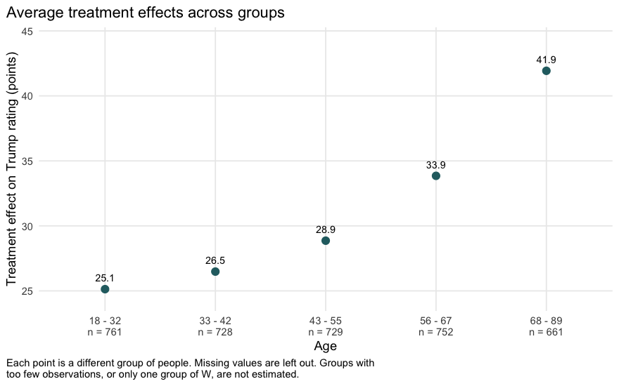
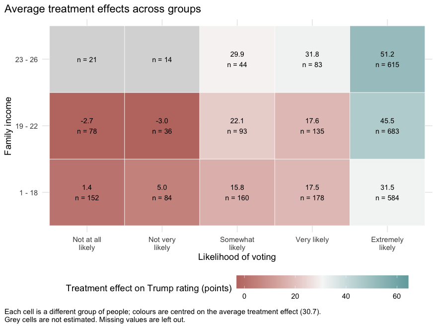

Quickstart: explore differences beyond the average
================

This tutorial shows how to explore whether the effect of one variable on
another is larger for some people than for others. You need three
things:

- a **dependent variable (Y)**, the outcome you want to explain: binary,
  with any two values (such as voted or did not vote), or continuous
  (such as a test score);
- an **independent variable (W)**, whose effect on Y you want to study:
  binary, with any two values (such as treated or untreated), or
  continuous (such as hours of use) (see the
  [README](../README.md#a-numeric-independent-variable));
- **characteristics (X)** that might moderate the effect, that is, make
  it larger or smaller.

A causal forest estimates the effect of W for people with different
characteristics and points to patterns worth investigating.

The example uses the 2024 General Social Survey (GSS). Y is a 0–100
rating of Donald Trump. W compares respondents who identify as
conservative with those who identify as liberal or moderate. Political
identification was not randomly assigned, so we read the results as
**adjusted associations**, not causal effects.

There are four steps: choose variables, run the forest, compare groups
and export results. The [app](../README.md#the-app) follows the same
steps without code.

## 1. Choose variables

Install the package and `gssr` as described in the
[README](../README.md#installation). Then load the package and download
the example:

``` r
library(heterogeneity)
gss <- load_gss2024()
```

`load_gss2024()` downloads the current GSS 2024 release and prepares it,
checking every recode against the GSS category labels; nothing is stored
in the package. `gss$data` has one row for each of the 3,721 respondents
with a value for both Y and W. `gss$covariates` names 31 demographic,
socioeconomic, religious, attitudinal and wellbeing characteristics, and
`gss$codebook` describes every column:

``` r
gss$codebook[gss$codebook$variable %in% c("rating_trump", "conservative", "age", "lkelyvot"), ]
```

    ##        variable                  label
    ## 2  rating_trump Rating of Donald Trump
    ## 3  conservative           Conservative
    ## 7           age                    Age
    ## 19     lkelyvot   Likelihood of voting
    ##                                                                                                                                                  coding
    ## 2                                                                                                                                     Numeric, 0 to 100
    ## 3  1 = slightly conservative / conservative / extremely conservative; 0 = extremely liberal / liberal / slightly liberal / moderate, middle of the road
    ## 7                                                                                                                                     Numeric, 18 to 89
    ## 19                                               1 = Not at all likely, 2 = Not very likely, 3 = Somewhat likely, 4 = Very likely, 5 = Extremely likely
    ##          source
    ## 2  ratechall124
    ## 3      polviews
    ## 7           age
    ## 19     lkelyvot

Choose characteristics that make sense for your question. Numbers are
treated as ordered values, so turn unordered codes (such as region
codes) into text or factors first; text columns are turned into 0/1
indicators automatically. If you want to read the results causally, use
only characteristics that W could not have changed.

**Keep missing characteristics.** The forest handles missing values
directly, so nothing needs to be filled in. Here the characteristic
missing most often is “Father’s education”, for 20.1% of respondents.
This avoids inventing values, but it does not remove bias when values
are missing for systematic reasons. Rows missing Y or W (or a supplied
weight or cluster) are left out, and the report lists every such change.

## 2. Run the forest

One call fits the forest, and printing the report shows a summary and
draws three plots. The labels are optional; here they come from the
example.

``` r
report <- explore_heterogeneity(
  data = gss$data, y = "rating_trump", w = "conservative",
  x = gss$covariates, ids = "id",
  labels = gss$labels, value_labels = gss$value_labels,
  effect_label = gss$effect_label
)
report
```

    ## Exploratory heterogeneity report
    ##   3,721 observations; 31 characteristics; 2,000 trees
    ##   Effect of W: Conservative minus Liberal/moderate
    ##   Average treatment effect: 30.72
    ##   In standard deviations: 0.96 (SD of rating_trump within the two groups: 32.04)
    ##   Estimated treatment effects range from 5.84 to 52.26
    ##   Results describe the analysis sample without weighting.
    ## 
    ## Candidate moderators (most used in tree splits):
    ##        characteristic importance rank
    ##  Likelihood of voting     0.5460    1
    ##         Family income     0.1120    2
    ##                 White     0.0731    3
    ##                   Age     0.0491    4
    ##    Years of education     0.0368    5
    ## 
    ## Data notes:
    ##   - More than 20% of values are missing for: padeg.
    ## 
    ## Check groups of interest with effect_by(). Estimated treatment effects describe
    ## covariate profiles and include noise; a causal interpretation depends on the
    ## research design.

**The summary.** The average treatment effect is **30.7 rating points**:
on average, conservative respondents rate Trump 30.7 points higher than
liberal/moderate respondents with similar characteristics. “Treatment
effect” is the standard name for this quantity; because W was not
randomly assigned here, it is an adjusted association rather than a
causal effect. It also differs from simply subtracting the two group
means, because it compares people with similar characteristics.

In standard deviations the average is **0.96**: the difference divided
by how much ratings vary within the two groups, before adjustment (one
standard deviation is 32.0 points). This standardized effect size can be
compared across outcomes measured in different units. Everything else
stays in rating points; dividing by `report$ate$sd_y` converts any of
it.

The forest also estimates a treatment effect for each combination of
characteristics (a conditional average treatment effect, CATE); these
range from 5.8 to 52.3 points. They come from 2,000 honest trees: each
tree uses one part of the data to choose its splits and another part to
estimate the effects, and each respondent’s estimate comes only from
trees grown without them (“out-of-bag”). The overall and group averages
use doubly robust scores, which combine the estimates with the observed
ratings. The candidate moderators are the characteristics the forest
used most in its splits, and the data notes list everything that was
changed or left out.

Below, the three plots are shown one at a time, each with its
explanation. `plot(report)`, `plot(report, "importance")` and
`plot(report, "profiles")` draw them on their own, for example to save
one.

``` r
plot(report)
```

<!-- -->

**Plot 1: distribution of estimated treatment effects, conditional on
covariates.** The histogram shows each respondent’s estimated treatment
effect, with the number of bins chosen from the data (the
Freedman–Diaconis rule). As in the heatmaps, the colours deepen with
distance from 0. Teal bars, above 0, are estimates in which conservative
respondents rate Trump higher than liberal/moderate respondents with
similar characteristics, and the further above 0, the deeper the teal;
red bars, below 0, would show the reverse. Here every estimated
treatment effect is above 0. These are model estimates: part of their
spread is estimation noise, so the plot is not the true distribution of
individual effects, and the smallest and largest estimates are the least
reliable.

``` r
plot(report, "importance")
```

<!-- -->

**Plot 2: candidate moderators of the treatment effect, ranked by
importance.** The chart ranks all 31 characteristics. The top-ranked one
is **Likelihood of voting**. Importance measures how often, and how
early, the forest split on a characteristic. That makes it a candidate
moderator, not a proven one: importance does not say whether the
treatment effect rises or falls with the characteristic, and related
characteristics share importance. For a text characteristic, the
importance of its indicators is added together.

``` r
plot(report, "profiles")
```

<!-- -->

**Plot 3: characteristics across treatment effect quintiles.** Each row
is a characteristic, in order of importance (a text characteristic gets
one row per category). Each column, labelled at the top, is a treatment
effect quintile: the respondents are sorted by their estimated treatment
effect and split into five groups of about equal size, from the bottom
20% to the top 20%. A cell shows the characteristic’s average in that
quintile, and the axis gives its range. The colours compare each average
with the characteristic’s overall average: teal above, red below, and
deeper the further away, measured in standard deviations of that
characteristic so that characteristics in different units can be
compared. For example, “Likelihood of voting” (range 1 to 5) averages
2.09 in the bottom 20% of estimated treatment effects and 5.00 in the
top 20%. Missing values are ignored. Because the quintiles are formed by
sorting the estimated treatment effects, some separation comes from the
sorting itself: use this plot to describe the forest’s pattern, and
check meaningful groups in step 3.

A few options are worth knowing. In a randomized experiment, supply the
known probability of being in the group coded 1, such as `W_hat = 0.5`;
otherwise, as here, the forest estimates it. Survey weights and clusters
can be supplied as `weights = "svy_weight"` and
`clusters = "psu_cluster"`; this illustration is unweighted, so it
describes these respondents. The default seed (21042020) makes the
results reproducible. With many characteristics, `top_n` limits the
importance and profile plots, for example
`plot(report, "importance", top_n = 10)`.

## 3. Compare groups

`effect_by()` is the focused check: it estimates the average treatment
effect within the groups of one characteristic. Likelihood of voting is
a natural first choice here, because it ranks 1 of 31 in importance.

``` r
voting <- effect_by(report, "lkelyvot")
voting
```

    ##    lkelyvot    n n_positive n_control n_treated   estimate status
    ## 1         1  283        283       211        72  0.5365313     ok
    ## 2         2  144        144       109        35  3.9418399     ok
    ## 3         3  333        333       248        85 22.5346014     ok
    ## 4         4  443        443       310       133 20.2629869     ok
    ## 5         5 2054       2054      1318       736 42.2616123     ok
    ## 6 (Missing)  464        464       338       126 22.1701473     ok

Each row is a group of respondents, labelled by its code (the codebook
above gives the meaning). `n_control` counts the liberal/moderate
respondents in the group and `n_treated` the conservative ones. A group
with fewer than 30 respondents, or with only one group of W, gets no
estimate, and its `status` says why. The average treatment effect is 0.5
points among respondents who are not at all likely to vote and 42.3
among those who are extremely likely. The table includes respondents
with a missing answer as a group of their own; the plot leaves them out:

``` r
plot(voting)
```

<!-- -->

These groups also differ in other ways, so the plot does not show what
would happen if someone’s likelihood of voting changed. Check
characteristics your theory names as well as the top-ranked ones:

``` r
age <- effect_by(report, "age")
plot(age)
```

<!-- -->

Age is cut into up to five groups of about equal size, labelled by the
ages they contain. The average treatment effect is 25.1 points for ages
18 - 32 and 41.9 for ages 68 - 89. These describe age groups, not the
effect of growing older, and the group boundaries are not thresholds.

Two characteristics give a heatmap:

``` r
plot(effect_by(report, "lkelyvot", "income16"))
```

<!-- -->

With two characteristics, numeric ones are cut into three groups each.
Income is recorded in ordered categories, not dollar amounts;
`gss$codebook` gives their meaning. Each cell shows an average treatment
effect and its number of respondents, coloured around the overall
average treatment effect. Grey cells have too few respondents, or only
one group of W, to be estimated. The heatmap leaves out respondents
missing either characteristic; the table from
`effect_by(report, "lkelyvot", "income16")` includes them.

## 4. Export results

Save the group estimates, the importance ranking and each respondent’s
estimated treatment effect as ordinary CSV files:

``` r
write.csv(effect_by(report, "age"), "age_groups.csv", row.names = FALSE)
write.csv(report$moderators, "importance.csv", row.names = FALSE)
write.csv(report$cates, "treatment_effects.csv", row.names = FALSE)
```

A short report can say:

> Among 3,721 GSS respondents, those identifying as conservative rated
> Trump 30.7 points (0.96 standard deviations) higher, on average, than
> liberal or moderate respondents with similar characteristics. The
> characteristics the forest used most were “Likelihood of voting”,
> “Family income” and “White”. Across voting-likelihood groups, the
> average treatment effect ranged from 0.5 to 42.3 points. The analysis
> was unweighted, and missing characteristics were kept for the forest
> rather than filled in. These patterns are exploratory: estimated
> treatment effects describe profiles and include noise.

Add the group estimates and counts relevant to your question. A causal
reading needs a defensible research design, comparable groups and
suitable characteristics; the GSS example makes no causal claim.

The [grf guide](https://grf-labs.github.io/grf/articles/grf_guide.html)
explains the underlying method and its handling of missing values. The
[Stanford
tutorial](https://bookdown.org/stanfordgsbsilab/ml-ci-tutorial/hte-i-binary-treatment.html)
gives more background.

    ##       Component Version
    ## 1             R   4.5.3
    ## 2 heterogeneity   0.2.0
    ## 3           grf   2.5.0
    ## 4          gssr     0.8
